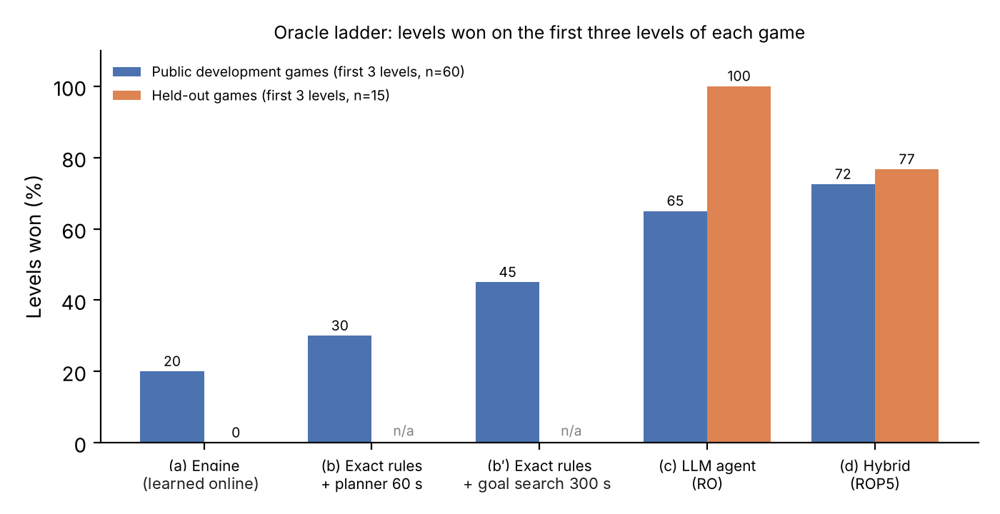

**Thomas Serval** — NEOMA Business School; Baracoda AI Labs · Linked submission: *ARC-AGI-3 Milestone 2 Solution*, version ROP5 v9 · Code and data: [github.com/Baracoda-ai-labs/arc-agi-3-oracle-ladder](https://github.com/Baracoda-ai-labs/arc-agi-3-oracle-ladder) (commit `40135bc`, MIT-0).

**Full paper (PDF, 10 pages):** [Serval_ARC-AGI-3_stagewise_audit.pdf](https://github.com/Baracoda-ai-labs/arc-agi-3-oracle-ladder/blob/main/paper/Serval_ARC-AGI-3_stagewise_audit.pdf)

## The question
Explicit model-based agents offer inspectable transition models and plans; their effectiveness depends on perception, induction and search. We built one, gated it inside a local LLM agent, submitted the hybrid, and asked which stage of the chain from pixels to actions stops it.

## The system
- **LLM agent (RO).** Franzen's public notebook (local quantised Qwen, SGLang, Python REPL) plus our deterministic tools after 40 actions: map of observed states, path-finding, surprise-checked traversal, memory of fatal actions.
- **Online engine.** Perceives cells and objects, learns a transition model from the consequences of its own actions, plans over it. No LLM, no network.
- **Gate (ROP5).** The engine opens at game start and once per level after 40 stagnant actions, in an isolated child process; the parent checks every engine action (deadline, terminal state, offered actions, frame identity), bounds budgets, and hands control back with a summary of what the engine did.
- **One declarative language for two worlds of games.** A GDL-style protocol, 17 mechanism contracts with declared read/write sets, and the move budget as an axiom. Exact programs replay 4,127/4,127 transitions of 20 public ARC-AGI-3 games, and one interpreter written in the language replays 177 human-made PuzzleScript games (38,924/38,924 moves).

## The oracle ladder (first three levels of each game)
| | Public dev (/60) | Held-out (/15) |
|---|---:|---:|
| Engine, model learned from play | 12 | 0 |
| Exact rules + goal-directed search, 1 M nodes / 300 s | 27 | — |
| LLM agent (RO) | 39 | 15 |
| Hybrid (ROP5) | 43.5 | 11.5 |

Held-out = five public games with disclosed incidental exposure, never used for development, preregistered runs. Native held-out scores: RO 42.98, ROP5 45.50 (two passages each; no established difference). ROP5 wins fewer held-out first levels (11.5 vs 15 of 15), losing levels on cn04 and wa30 in both passages; the gate's overhead is a plausible cause we did not isolate. Kaggle leaderboard (hidden games): ROP5 22.55, RO 27.34 and 29.89 for two identical submissions — single submissions vary by several points.

**Two bottlenecks.** (1) The end-to-end symbolic pipeline does not carry over to new games: 12 → 0. Inside the hybrid, on new games the engine opens 19 times, plays 2 % of the actions and wins no level during an opening; 18 openings stopped at player-motion identification (9) or structure recognition (9), and one ended in defeat. No hypothesis was generated in these logs. On 104 procedurally generated games outside ARC, an earlier version of the chain wins 5 first levels and stops or loses on the rest, mostly at perception and recognition. A simple chain model (P(win) is the product of stage success probabilities) reads why downstream improvements added no level, and a gate-value condition says a gate pays only when the engine is likely to recognise the game. (2) Even with source-derived exact rules our bounded search trails an LLM agent with no game-specific knowledge (27 vs 39; paired with each agent passage, 16 to 6 and 19 to 5 on levels won by only one), and faster search did not add solved levels under the budgets tested.

## Why — three checkable propositions
Because the language declares what each mechanism reads and writes:
1. **Sufficiency.** If two different frames get the same represented state and the same action leads to different outcomes, no downstream learner can predict both. A cheap check on recorded play found three such pairs in KA59 (18 pixels never sampled); it identifies a limitation of the represented input, without explaining every unsuccessful inducer variant.
2. **Independence.** Actions whose read/write sets do not interfere commute (24/24 predicted, 0 false in 311 checks). Pruning by an extended commutation rule cuts search by up to 77 % with identical plans — yet wins no new level: the measured speedups did not increase solves under the evaluated budgets.
3. **Distinguishability.** Competing theories are separated only by a move where they predict differently; the language finds it (G50T level 6).

A stage-by-stage loss map on nine blocked games shows heterogeneous first failures: sampling, facts, theory, revision, domain, goal.

## Reusable diagnostic procedure
Record each stage's inputs and outputs, identify a local counterexample, locate the first faulty transformation, replace only that interface when a trusted reference is available, replay downstream stages unchanged, compare against an exact OFF control, and label the result as observed defect, intervention evidence or unresolved hypothesis. Report coverage; no observed representation collision is not a certificate of sufficiency. Repairs on reused development traces are not independent gameplay gains.

## Availability
The linked notebook is [ARC-AGI-3 Milestone 2 Solution](https://www.kaggle.com/code/thomasserval/arc-agi-3-milestone-2-solution), ROP5 v9, native scriptVersionId364167125. Code and data are public at [github.com/Baracoda-ai-labs/arc-agi-3-oracle-ladder](https://github.com/Baracoda-ai-labs/arc-agi-3-oracle-ladder) (commit `40135bc`); the notebook alone does not reproduce the offline diagnostics. Exact programs are source-inspected oracles. Author-owned research code is released under MIT-0; upstream components retain their own licences.
